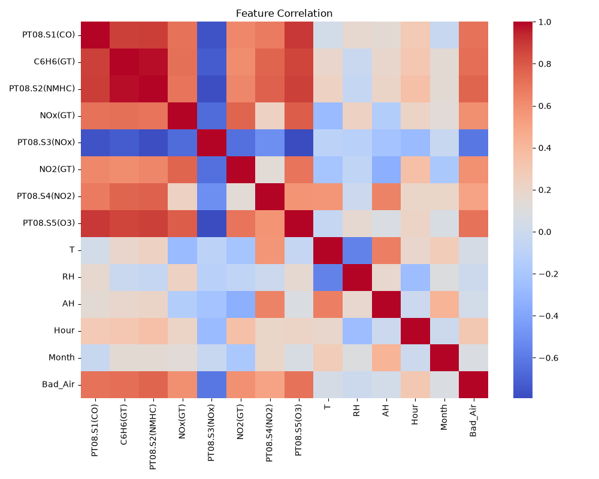
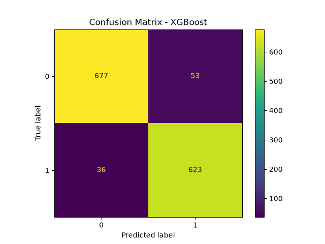
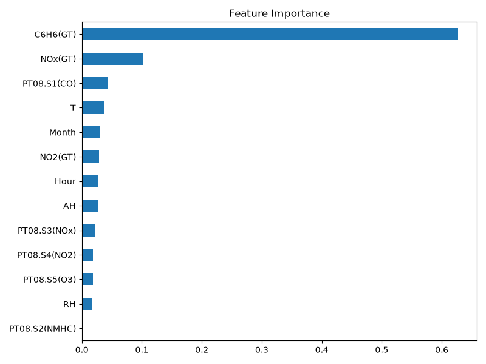

# Air Quality Prediction System

A machine learning project that predicts whether air quality is **bad** from gas-sensor and weather readings, plus a command-line tool that reports Good / Moderate / Bad with health advisories.

## Dataset
[UCI Air Quality dataset](https://archive.ics.uci.edu/dataset/360/air+quality): 9,357 hourly records from a multi-sensor device (CO, benzene, NOx, NO2, ozone, temperature, humidity).

## Approach
1. **Cleaning:** replaced sensor error values (-200) with NaN, dropped `NMHC(GT)` (mostly missing) and removed remaining incomplete rows: 9,357 to **6,941** rows.
2. **Target:** `Bad_Air = 1` when `CO(GT) >= 2.0` (class split about 52% / 47%).
3. **Feature engineering:** `Hour` and `Month` derived from the timestamp.
4. **Modelling:** Random Forest, SVM, Decision Tree and XGBoost, each in a scikit-learn Pipeline (StandardScaler + model) so scaling is fitted on training data only.
5. **Evaluation:** stratified 80/20 split, 5-fold cross-validation, accuracy, precision, recall and F1. The best model is chosen by cross-validation F1, not by the test set.

## Results
| Model | CV F1 | Accuracy | Precision | Recall | F1 |
|---|---|---|---|---|---|
| **XGBoost** | 0.9375 | 0.9359 | 0.9216 | 0.9454 | 0.9333 |
| Random Forest | 0.9341 | 0.9359 | 0.9318 | 0.9332 | 0.9325 |
| SVM | 0.9282 | 0.9302 | 0.9258 | 0.9272 | 0.9265 |
| Decision Tree | 0.9057 | 0.9122 | 0.8954 | 0.9226 | 0.9088 |





## Project structure
```
.
├── data/AirQualityUCI.xlsx
├── src/
│   ├── train.py      # clean, engineer features, compare models, save best
│   └── predict.py    # command-line diagnosis tool
├── models/           # saved pipeline (created by train.py)
├── outputs/          # results table and figures
├── requirements.txt
└── README.md
```

## Run locally
```
python -m venv venv
venv\Scripts\activate          # Windows (Linux/Mac: source venv/bin/activate)
pip install -r requirements.txt
python src/train.py
python src/predict.py
```

## Limitations
- `PT08.S1(CO)` is a CO sensor, so it is closely related to the CO-based target. Performance on a different site or without this feature may be lower.
- The 2.0 threshold is a chosen cutoff, not an official standard.
- Data comes from one location in Italy (March 2004 to April 2005).
- The Good/Moderate/Bad thresholds in `predict.py` are illustrative.

## Tech stack
Python, pandas, NumPy, scikit-learn, XGBoost, Matplotlib, Seaborn, joblib